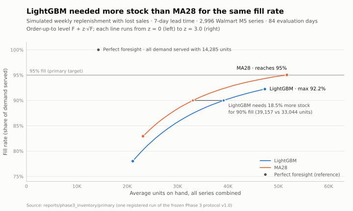
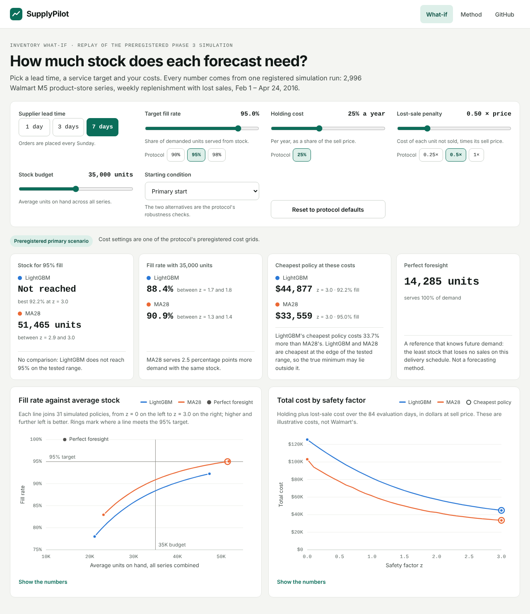
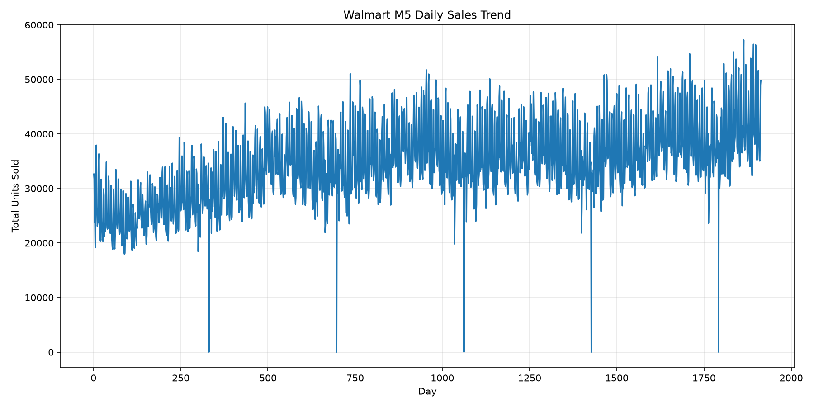
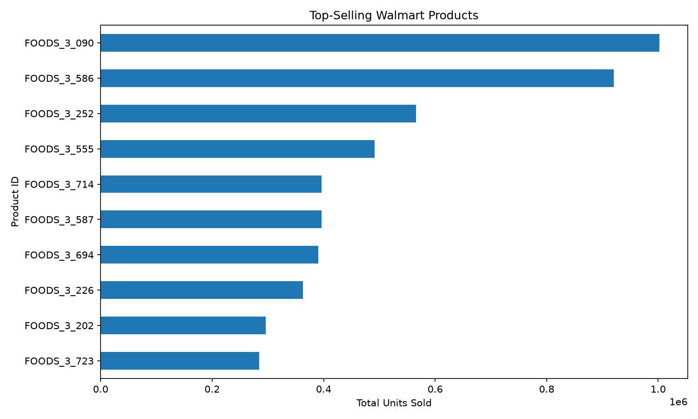

# SupplyPilot AI

[](https://github.com/alennchik/supplypilot-ai/actions/workflows/ci.yml)

**Retail demand forecasting and preregistered inventory simulation on Walmart M5 data**

SupplyPilot AI forecasts daily demand for 3,000 Walmart product-store series from the [M5 Forecasting dataset](https://www.kaggle.com/competitions/m5-forecasting-accuracy/data) and tests whether a more accurate forecast leads to better replenishment decisions. The final forecast benchmark and the inventory simulation each followed a protocol frozen before its run, and each was run exactly once.

**Main finding:** a global LightGBM model beat a 28-day moving average (MA28) on daily forecast error, with 1.18% lower daily WAPE. In the inventory simulation, however, LightGBM needed **18.5% more stock than MA28 for a 90% fill rate** at a 7-day lead time. Replenishment orders depend on demand totals over several days, and MA28 was more accurate on weekly and 28-day totals. The preregistered primary comparison, at a 95% fill rate and the same lead time, could not be computed because LightGBM never reached 95%.

<picture>
  <source media="(prefers-color-scheme: dark)" srcset="reports/phase3_inventory/figures/fill_rate_vs_stock_l7_dark.svg">
  
</picture>

| Area | What it covers |
|---|---|
| **Data** | 3,000 sampled product-store series and 4.55 million daily rows, stored as Parquet |
| **Forecasting** | Naive, seasonal naive and MA28 baselines, and a global LightGBM (Tweedie) model, compared over four 28-day windows |
| **Inventory** | A lost-sales periodic-review simulator: 2 forecasters × 3 lead times × 31 safety-stock levels, plus a perfect-foresight reference |
| **Rigor** | Preregistered protocols, SHA-256 provenance checks, single registered runs, and 800+ automated tests in CI |
| **App** | A FastAPI service and a React + TypeScript page that answer inventory what-if questions from the published results, plus a planning assistant whose answers are checked against its tool results |

**Jump to:** [Final ML benchmark](#frozen-final-ml-benchmark--issue-28) · [Inventory simulation](#phase-3-inventory-simulation-frozen-protocol-v10) · [Getting started](#getting-started) · [Roadmap](#project-roadmap) · [Scope and limitations](#data-and-scope-notes)

## Project Status

Phases 0–3 are complete: the data pipeline, the baseline backtest, LightGBM development and the final benchmark, and the inventory simulation. Phase 4 is in progress: the [inventory what-if app](#phase-4-planning-app-in-progress) and a [planning assistant](#planning-assistant) that answers questions through the same engine are built. A live evaluation of the assistant and a public deployment come next.

**Development cycles:** The data engineering pipeline, three-model baseline backtest, leakage-aware multi-horizon feature pipeline, and **two preregistered LightGBM development cycles** are complete. Cycle 1 evaluated nine configurations and selected Tweedie / 8 origins at **80.8670% daily pooled V2 WAPE**. Calendar-Aware Cycle 2 evaluated two candidates and adopted **`cycle2_tweedie_8_origins_calendar` at 79.8558%**, versus **83.4165%** for matched MA28. Both development cycles were independently reproduced. Cycle 2 covers **2,992 eligible series from the fixed 3,000-series sample**, not the full 30,490-series M5 population. The adopted model improves daily and weekly WAPE over Cycle 1 but slightly worsens 28-day aggregated WAPE.

**Final ML benchmark (Issue #28):** completed and published at source commit `fa201bc741dc`. [Final results](#completed-final-results) favor LightGBM on daily WAPE and MAE, and MA28 on weekly WAPE, 28-day WAPE, and RMSE. Independent reproduction of this final run was **not performed**.

**Inventory simulation (Phase 3):** completed. A [preregistered inventory simulation](#phase-3-inventory-simulation-frozen-protocol-v10) compared the two methods under identical replenishment rules in one registered run. The primary endpoint (inventory needed for a 95% fill rate) is **not estimable**, because LightGBM never reached 95% on the preregistered grid. In the descriptive comparisons, MA28 had the better trade-off in every scenario: LightGBM needed **7.1–18.5% more inventory for a 90% fill rate**, depending on lead time. These are simulation results under explicit assumptions, not measured savings. A dashboard and inference from new raw sales files remain future work.

## Highlights

- **58,327,370** original daily sales values verified during wide-format CSV-to-Parquet conversion.
- **3,000** reproducibly selected product-store series; **4,550,960** unified daily observations.
- **Phase 1 final-window baseline benchmark:** 2,996 eligible series across four 28-day windows; **1,006,656 total predictions** across three baseline methods. These are **not** the Phase 2 validation windows.
- **Phase 1 baseline benchmark:** MA28 had **74.38% pooled WAPE** across the four later windows, versus **86.98%** for seasonal naive and **97.96%** for naive; these figures **must not** be compared directly with Phase 2 V2 WAPE.
- **Phase 2 model selection:** 9 preregistered LightGBM candidates, 2,992 fixed V1/V2 series, and 83,776 V2 forecasts per candidate. Selected Tweedie (8 origins): **80.8670% WAPE**, **0.9832 MAE**, **2.4318 RMSE**; MA28 on those V2 rows: **83.4165% WAPE**.
- **Calendar-Aware Cycle 2:** adopted 8-origin Tweedie: **79.8558% daily**, **42.5783% pooled weekly**, **32.1468% 28-day aggregated WAPE**; both candidates and the adoption decision reproduced in two independent runs. See [results and limitations](#completed-cycle-2-results).
- **Completed frozen final evaluation:** LightGBM **73.5035% daily pooled WAPE** versus MA28 **74.3784%** on 2,996 series and four windows: approximately **0.875 percentage points**, or **1.18% relative error reduction**. MA28 wins the aggregated WAPE metrics and RMSE; see [final results and limitations](#completed-final-results).
- **Phase 3 inventory simulation:** one registered run of a frozen protocol on the same 2,996 series: 2 methods × 31 safety-stock levels × 3 lead times × 3 variants, plus a perfect-foresight reference. The primary endpoint is **not estimable**: at a 7-day lead time LightGBM tops out at **92.2%** fill, while MA28 reaches 95%. In the descriptive comparisons, LightGBM needed **7.1–18.5% more inventory for 90% fill**, and MA28 had lower illustrative cost at every grid point. See [Phase 3 results](#phase-3-inventory-simulation-frozen-protocol-v10).
- **Cycle 1 reproducibility:** second run matched all nine WAPE scores within `1e-9` and all nine `best_iteration` values exactly; **11,744 V1 learning-curve points** recorded.
- Automated unit and integration tests cover both ML cycles and the inventory simulation; run Pytest and Ruff with the commands below. GitHub Actions CI checks changes on pull requests and on `main`.
- Wide Parquet storage is **73.2% smaller** than CSV, with **17.94× faster** median full-table loading in the measured local benchmark (not a universal performance guarantee).
- **668,808 cutoff-bounded supervised ML rows** generated across eight weekly training origins, 28 forecast horizons, and 2,989 unique eligible series; 2.80 s generation time and 850.81 MiB process peak RSS on the local Mac benchmark.
- **Initial model persistence smoke test:** 4.96 s fitting time for a separate 100-tree regression model, 451.70 MiB peak process RSS, and a successful 28-horizon save/reload test on a MacBook Air M2 (8 GB RAM). This preliminary test is distinct from the nine-candidate validation experiment.

## Current Capabilities

### Data Engineering

- Validate M5 identifiers and sales quantities, including null, negative, and integer-range checks.
- Convert the 30,490-series, 1,913-day wide M5 CSV to Apache Parquet using PyArrow.
- Process large datasets in batches and use temporary files followed by atomic replacement for individual outputs.
- Verify converted Parquet values against the original CSV.
- Deterministically sample 3,000 product-store series using stratification and SHA-256 ranking.
- Join sales with calendar dates and weekly observed prices to construct a unified daily sales table.
- Keep product metadata in a separate series table; preserve observed zero sales and distinguish them from missing history.

### Exploratory Analysis and Feature Engineering

- Analyze aggregate sales trends, top-selling products, and zero-sales behavior.
- Generate lag-1, lag-7, and lag-28 features and historical 7-day/28-day moving averages.
- Use chronological train/validation splits and avoid current-day target leakage in the earlier one-step feature pipeline.
- Compute additional origin-relative demand lags (1, 7, 14, 28), historical rolling averages, sums, standard deviations, and zero-sales fractions for direct 28-day ML examples.
- Build supervised rows with forecast horizons 1–28 and labels strictly at or before a configurable training cutoff; preserve missing-history values as `NaN`.

### Demand Forecasting and Evaluation

- Preserve preliminary one-step-ahead naive and seasonal-naive forecasting checks.
- Implement **direct 28-day** naive, seasonal naive (7 days), and moving average (28 days) baselines.
- Evaluate four non-overlapping chronological forecast windows with the same eligible product-store series.
- Calculate overall, per-window, per-category, and per-demand-sparsity MAE, RMSE, and **pooled WAPE**.
- Generate reproducible prediction files, CSV reports, and an experiment manifest.
- Generate reproducible ML training Parquet and a JSON dataset manifest; train a global LightGBM regressor across all 28 forecast horizons, save/load the model and category vocabulary, and record a model-training manifest.
- Predict nonnegative daily demand from **already-prepared origin-relative feature rows**. Select and evaluate global regression, Poisson, and Tweedie LightGBM models on fixed V1/V2 validation windows using early stopping and pooled WAPE; generate MAE/RMSE, learning curves, resource reports, and MA28 diagnostics.
- Opt into Calendar-Aware Cycle 2: add seven scheduled target-date predictors, compare two frozen Tweedie configurations, report daily/weekly/28-day WAPE for four matched methods, and apply the preregistered adoption rule automatically. Completed results and the reproduced adoption decision are documented below for the fixed sampled cohort.
- Complete the frozen four-window final ML benchmark with one fit, blind structural preflight, and a separate one-time metrics reveal; saved results and publication provenance are documented below.
- **Not yet implemented:** automated end-to-end inference from a new raw sales-history file.

### Inventory Simulation

- Simulate weekly periodic-review, order-up-to replenishment with lost sales for all series at once, with configurable lead time, rounding rule and starting stock (`src/inventory_simulation.py`).
- Build order-up-to levels `F + z·√F` from weekly forecast paths, plus a perfect-foresight policy reference (`src/inventory_policy.py`).
- Compute pooled fill rate, stockout rate, average on-hand, deliveries, value-weighted metrics, illustrative costs, interpolated fill-rate endpoints and a paired item-cluster bootstrap (`src/inventory_metrics.py`).
- Rebuild weekly LightGBM and MA28 forecast paths from hash-verified snapshots, and check them against Issue #28 and Phase 1 before any inventory metric is computed (`src/inventory_inputs.py`, `src/inventory_ml_forecasts.py`).
- Run the frozen experiment once, with an exclusive run registration, sealed results with checksums, and publication without recomputation (`scripts/run_inventory_simulation.py`, `src/inventory_publication.py`).
- Draw the fill-rate-versus-stock chart from the published reports in light and dark variants, with byte-identical output on every run (`src/inventory_plots.py`, `scripts/plot_inventory_tradeoff.py`).

### Planning App

- Answer inventory what-if questions from the published Phase 3 curves: stock for a target fill rate, fill rate for a stock budget, and the cheapest policy for any holding cost and lost-sale penalty, with the perfect-foresight reference (`src/inventory_whatif.py`).
- Check every published file against `checksums.json` before use, and label settings outside the protocol as exploratory in every answer.
- Serve the answers over HTTP with FastAPI (`api/main.py`) and show them on a React + TypeScript page with interactive SVG charts, keyboard support and table views (`web/`).
- Answer plain-English questions with a tool-calling planning assistant (Anthropic or OpenAI) whose every number is checked against the tool results, with a fixed evaluation set (`src/planning_agent.py`, `src/agent_eval.py`).

### Quality and Automation

- Pytest unit and integration tests, including future-data leakage, calendar boundaries, missing data, duplicate keys, reproducibility, and failed-write protection.
- Ruff linting and formatting; pinned dependencies and GitHub Actions CI.
- Source datasets, generated Parquet predictions, and trained model binaries excluded from version control; compact experiment reports can be tracked.

## Getting Started

### 1. Clone and install

Python 3.13 is the tested development environment.

```bash
git clone https://github.com/alennchik/supplypilot-ai.git
cd supplypilot-ai
python3 -m venv .venv
source .venv/bin/activate
python -m pip install -r requirements.txt
```

### macOS setup for LightGBM

On macOS, LightGBM may require the OpenMP runtime. Install it using Homebrew:

```bash
brew install libomp
```

Then install the Python dependencies as described above. The initial model was trained and tested on a MacBook Air M2 (8 GB RAM) using Python 3.13.1, LightGBM 4.7.0, and scikit-learn 1.9.1.

On Linux or Windows, follow the platform-specific LightGBM installation requirements; Homebrew is not required. The standalone training entrypoint (`scripts/train_ml_model.py`) uses the Unix `resource` module for process memory reporting and has been tested on macOS, not native Windows. A Unix-like environment is recommended for reproducing that resource report.

### 2. Download the M5 input files

Download the data from the [M5 Forecasting – Accuracy competition](https://www.kaggle.com/competitions/m5-forecasting-accuracy/data) and place the following files in `data/raw/`:

```text
data/raw/sales_train_validation.csv
data/raw/calendar.csv
data/raw/sell_prices.csv
```

The repo does **not** bundle the source data. Raw and processed datasets are ignored by Git.

### 3. Build the datasets

Run from the repository root:

```bash
python -m scripts.convert_to_parquet
python -m scripts.verify_parquet
python -m scripts.sample_m5
python -m scripts.build_m5_unified
```

This produces `data/processed/sales_train_validation.parquet`, `series.parquet`, and `sales.parquet` (among other intermediate files). The fixed sampled series IDs are tracked in `reports/sample_series.csv`; the sampling script checks against this manifest to detect accidental sample changes.

### 4. Run the 28-day forecasting benchmark

```bash
python -m scripts.run_backtesting
```

The default M5 experiment ends on **2016-04-24**, and writes a detailed prediction Parquet file to `data/processed/` and summary reports to `reports/`. Use `python -m scripts.run_backtesting --help` for custom input/output paths and evaluation end date. Changing the end date changes the evaluation protocol; use the fixed default to reproduce the published results.

### 5. Build the Phase 2 ML training dataset

After preparing the unified daily data in step 3, run:

```bash
python -m scripts.build_ml_dataset --cutoff 2015-11-08 --origins 8
```

This generates `data/processed/ml_training.parquet` (ignored by Git) and `reports/ml_training_manifest.json` (version-controlled). No LightGBM dependency is needed to generate the dataset. The fixed cutoff and weekly origins reproduce the documented experiment; run `python -m scripts.build_ml_dataset --help` for optional paths and origin count.

### 6. Train the initial global LightGBM model

After generating `data/processed/ml_training.parquet`, run from the repository root:

```bash
python -m scripts.train_ml_model
```

The default run fits one CPU LightGBM regression model (100 boosting rounds, two threads, seed 42) to examples with labels through **2015-11-08**. It writes `models/global_lightgbm.txt` (LightGBM trees), `models/global_lightgbm.json` (training-time categorical vocabulary and feature schema), and `reports/ml_model_training_manifest.json` (configuration, runtime, environment, and training counts). The `models/` directory is excluded from Git; the report is intended to be version-controlled. You can inspect options with `python -m scripts.train_ml_model --help`.

This is a **training and persistence smoke test**, not a validation score. The script checks the training cutoff and reload consistency on one prepared 28-day forecast path. It does not run the later validation or final-test evaluation.

### 7. Reproduce the preregistered LightGBM validation

After preparing `data/processed/sales.parquet` and `data/processed/series.parquet`, first inspect the fixed protocol without training:

```bash
python -m scripts.run_ml_validation
```

To **actually train all nine candidates** and write the reports to `reports/`:

```bash
python -m scripts.run_ml_validation --execute
```

The command trains regression, Poisson, and Tweedie objectives with 8, 16, and 32 weekly origins. It uses V1 only for early stopping and V2 for the prespecified selection rule. The later four-window final evaluation is not used. See [Phase 2 validation results](#preregistered-v1v2-lightgbm-validation).

**Runtime warning:** this is a full nine-model training experiment (approximately 16 minutes 27 seconds for the documented second run on a MacBook Air M2); it is **not** the separate 100-tree smoke test in step 6.

### 8. Inspect or reproduce Calendar-Aware Cycle 2

The Cycle 2 implementation has a separate opt-in runner and report namespace. Inspect its frozen protocol without reading data or fitting models:

```bash
python -m scripts.run_cycle2_calendar
```

A full run requires the prepared M5 sales and metadata Parquet files **and** `data/raw/calendar.csv`. See [Calendar-Aware LightGBM Cycle 2](#calendar-aware-lightgbm-cycle-2) for execution and independent-reproduction commands. The completed sampled-cohort experiments and adoption decision are saved under `reports/cycle2_calendar/first_run/` and `reports/cycle2_calendar/repro_run/`; these are not full-population M5 results.

### 9. Run quality checks

```bash
python -m ruff check .
python -m pytest -q
```

Tests use synthetic inputs and do not require Kaggle data. A Pandas `RuntimeWarning` from a deliberately invalid-value test is known in the original suite. A successful local run does not itself mean GitHub Actions CI has run for an unmerged change.

## M5 Parquet Storage and Performance

The wide-format converter preserves **30,490 product-store series**, **1,919 columns** (six identifiers plus 1,913 daily values), and **58,327,370** historical sales observations. It validates quantities before storing them in a compact integer format and uses temporary-file replacement to protect a valid output from unsuccessful conversion.

Verification on the full source dataset found matching identifiers and sales values in the original CSV and converted Parquet output.

### Local performance benchmark

Measured on macOS with Python 3.13.1, Pandas 3.0.6, and PyArrow 26.0.0. Three runs per loading scenario; values shown are medians.

| Metric | CSV | Parquet | Result |
|---|---:|---:|---|
| Full-table loading | 1.810 s | 0.101 s | **17.94× faster** |
| IDs plus last 365 days | 0.666 s | 0.041 s | **16.14× faster** |
| Full-load peak memory | 368.6 MiB | 410.6 MiB | Higher with Parquet |
| Recent-load peak memory | 171.6 MiB | 176.4 MiB | Higher with Parquet |
| File size | ~114 MiB | 30.62 MiB | **73.2% smaller** |

The timing scenarios load either all 1,919 columns or the six identifier columns plus the last 365 sales days. CSV uses explicit data types; Parquet is read through Pandas/PyArrow. Each timed load runs in a separate process; execution order is randomized with a fixed seed. Operating-system filesystem caches were not cleared. Peak memory includes Python and library overhead.

Parquet improved disk usage and load time **but did not reduce measured peak memory**. These results describe this environment, dataset, and benchmark, not guaranteed speedups elsewhere.

Reproduce the benchmark with:

```bash
python -m scripts.benchmark_parquet --repeats 3
```

Detailed runs and environment information are in [`reports/parquet_benchmark.json`](reports/parquet_benchmark.json).

## Reproducible M5 Sampling and Unified Daily Data

### Sampling methodology

Exactly **3,000 of 30,490** product-store series were selected using metadata alone, without inspecting demand values. The algorithm allocates sample sizes proportionally across the **30 `store_id × cat_id` strata** by the largest-remainder method, breaking ties deterministically, then ranks series using SHA-256 with seed `42`.

For each of ten stores, the selected sample contains:

| Category | Series per store |
|---|---:|
| FOODS | 141 |
| HOBBIES | 56 |
| HOUSEHOLD | 103 |
| **Total** | **300** |

The full list of chosen IDs is stored in [`reports/sample_series.csv`](reports/sample_series.csv) for reproducibility.

### Output schema

| File | Contents |
|---|---|
| `data/processed/sales_train_validation.parquet` | Verified original wide-format M5 sales |
| `data/processed/series.parquet` | `series_id`, `item_id`, `dept_id`, `cat_id`, `store_id`, `state_id` |
| `data/processed/sales.parquet` | `series_id`, `date`, `quantity`, `price`, `price_available` |

The unified pipeline maps M5 `d_1`–`d_1913` columns to real dates and joins weekly observed prices on `store_id`, `item_id`, and `wm_yr_wk`. It removes each series' days **before the first observed price** as a proxy for available history—not as proof of a product launch. Observed zero-sales days are retained. Missing later prices would remain null with `price_available = False`, although **none occurred after trimming in this particular sample**.

An observed price does not prove inventory availability, so missing prices and stockouts must not be conflated. Baseline forecasts in this phase use **only historical sales quantities**, not future prices or calendar/event features.

### Local data validation

| Metric | Result |
|---|---:|
| Selected product-store series | 3,000 |
| Unified daily rows | 4,550,960 |
| Zero-sales rows | 2,724,948 (about 60%) |
| Missing prices after trimming | 0 |
| Average available history | Approximately 1,517 days per series |

Checks covered unique series/date pairs, consecutive dates within each series, valid quantities, and price-availability consistency. Independently comparing all **4,550,960 retained daily quantities** to the original M5 wide table found no mismatches.

## Direct 28-Day Forecasting and Rolling-Origin Backtesting

The primary benchmark evaluates **28-day-ahead paths predicted at a fixed origin**, not one-step forecasts that can use actual sales from earlier days inside the test period.

### Baseline models

| Model | Prediction for the next 28 days |
|---|---|
| **Naive** | Repeat the last observed daily quantity for every forecast day |
| **Seasonal naive (7)** | Repeat the last seven observed daily quantities four times |
| **Moving average (28)** | Repeat the average daily quantity from the previous 28 observed days |

These models are implemented in `src/forecast_baselines.py`. Earlier one-step baselines remain in `src/baselines.py` as separate preliminary checks.

### Evaluation protocol

- **Dataset:** 3,000 sampled Walmart M5 product-store series; daily dates through **2016-04-24**.
- **Horizon:** 28 calendar days per origin, with **four non-overlapping final-evaluation windows**.
- **Eligibility:** at least 28 consecutive observed historical days at the **first** evaluation origin (`2016-01-03`); **2,996 eligible**, **4 excluded**. This cohort stays fixed for all models and windows.
- **No leakage:** each forecast receives only historical demand available through its origin. Earlier completed windows become historical data at later origins; future actual sales never enter the same origin's forecast inputs.
- **Missingness:** absence of an observation is `NaN`, not zero. Missing target observations for an already eligible series raise an error instead of silently removing the series.
- **Comparison:** all three models use identical eligible series, dates, forecast origins, and actual quantities.

| Window | Forecast origin | 28-day prediction period |
|---|---|---|
| 1 | 2016-01-03 | 2016-01-04 to 2016-01-31 |
| 2 | 2016-01-31 | 2016-02-01 to 2016-02-28 |
| 3 | 2016-02-28 | 2016-02-29 to 2016-03-27 |
| 4 | 2016-03-27 | 2016-03-28 to 2016-04-24 |

Each model has **335,552** evaluated daily predictions (`2,996 × 4 × 28`), for **1,006,656 total prediction rows**. The combined actual demand over those 335,552 target observations is **482,952 units** (the same target set for every model).

### Error metrics

- **MAE:** mean absolute daily error, in units sold.
- **RMSE:** root mean squared daily error, in units sold; penalizes larger misses more.
- **Pooled WAPE:** `100 × sum(abs(actual − predicted)) / sum(actual)` over **all observations in the reported group**. It is **not** an average of per-series WAPE percentages.
- **Undefined WAPE:** if a group's total actual demand is zero, WAPE is reported as missing (`NaN`), not zero.

All three metrics are calculated through the existing implementations in `src/metrics.py` using numerical arrays converted to `float64`.

**WAPE is an error metric, not an accuracy percentage.** Since actual demand is nonnegative, an **always-zero** forecast would have exactly **100% WAPE** when total actual demand is positive. This is a mathematical reference point, **not a separately executed model in the benchmark**.

### Overall results

| Model | MAE ↓ | RMSE ↓ | Pooled WAPE ↓ |
|---|---:|---:|---:|
| **Moving average (28)** | **1.071** | **2.600** | **74.38%** |
| Seasonal naive (7) | 1.252 | 3.096 | 86.98% |
| Naive | 1.410 | 3.499 | 97.96% |

**Finding:** the 28-day moving average has the lowest MAE, RMSE, and pooled WAPE of the three tested baselines on this fixed M5 evaluation. Its pooled WAPE is **23.58 percentage points lower than naive**, a **24.1% relative reduction in aggregate absolute error**. This is a baseline benchmark, not evidence of production-ready forecast quality.

### Performance by demand intermittency

Demand groups were defined using each eligible series' proportion of zero-sales days in **at most the 365 days ending at the first forecast origin (`2016-01-03`)**. Series with shorter history use their available observed days (minimum observed: 58). Group definitions were fixed **before looking at forecasting errors**:

- **Frequent:** fewer than 25% zero-sales days.
- **Mixed:** 25%–75% zero-sales days, inclusive.
- **Sparse:** more than 75% zero-sales days.

| Demand group | Series | MA28 WAPE ↓ | Seasonal naive WAPE ↓ | Naive WAPE ↓ |
|---|---:|---:|---:|---:|
| Frequent | 334 (11.15%) | **51.92%** | 63.32% | 74.31% |
| Mixed | 1,584 (52.87%) | **88.48%** | 103.22% | 114.31% |
| Sparse | 1,078 (35.98%) | **115.25%** | 122.81% | 133.10% |

**Finding:** the moving average wins in all three demand groups, but even its error exceeds the always-zero **100% WAPE reference** for sparse demand. Forecasting rarely sold items remains a significant problem. That observation does **not** justify tuning a model or choosing a special strategy using these final-test results.

Frequent series make up only **11.15% of series** but account for approximately **45.04% of target demand** in this evaluation. Sparse series account for **35.98% of series** but only about **8.84% of target demand**. This helps explain why overall pooled WAPE is closer to the errors of higher-volume groups.

### Performance by category

| Category | Series | MA28 WAPE ↓ | Seasonal naive WAPE ↓ | Naive WAPE ↓ |
|---|---:|---:|---:|---:|
| FOODS | 1,406 | **68.32%** | 79.64% | 90.13% |
| HOUSEHOLD | 1,030 | **80.25%** | 95.25% | 105.78% |
| HOBBIES | 560 | **102.84%** | 118.74% | 134.17% |

The moving average is best among the tested methods in all three categories. HOBBIES has the highest relative error; these tables alone do not establish why.

### Stability across test windows

| Prediction period | MA28 WAPE ↓ | Seasonal naive WAPE ↓ | Naive WAPE ↓ |
|---|---:|---:|---:|
| Jan 4–31, 2016 | **79.04%** | 92.89% | 100.59% |
| Feb 1–28, 2016 | **72.28%** | 83.88% | 97.79% |
| Feb 29–Mar 27, 2016 | **73.64%** | 85.12% | 95.54% |
| Mar 28–Apr 24, 2016 | **72.96%** | 86.58% | 98.18% |

The ranking is consistent across all four windows. The first window has the highest MA28 WAPE; its lower total actual demand also contributes to the larger relative error. Causes such as holidays have **not** been established by this analysis.

### Reproduce the forecasting benchmark

After completing the data preparation steps, run:

```bash
python -m scripts.run_backtesting
```

The script loads `sales.parquet` and `series.parquet`, generates the direct 28-day predictions, creates historical demand groups, evaluates all models using existing metrics, and saves:

| Output | Version-controlled? | Purpose |
|---|---|---|
| `data/processed/m5_backtest_predictions.parquet` | No | Detailed actual and predicted demand by series, origin, date, and model |
| `reports/m5_baselines_overall.csv` | Yes | Overall model metrics |
| `reports/m5_baselines_by_window.csv` | Yes | Metrics per forecast origin |
| `reports/m5_baselines_by_category.csv` | Yes | Metrics by product category |
| `reports/m5_baselines_by_sparsity.csv` | Yes | Metrics by demand group |
| `reports/m5_demand_group_summary.csv` | Yes | Demand-group sizes and pre-test zero-sale fractions |
| `reports/m5_backtesting_manifest.json` | Yes | Evaluation windows, models, cohort size, and grouping rules |

Reports are recomputable from the M5 inputs. The script uses temporary files and atomic replacement for **each output**, but the collection of reports is not one all-or-nothing transaction. Tests use small synthetic Parquet files, so CI does not require the large M5 dataset.

### Limitations and evaluation integrity

- The evaluation covers a **deterministic 3,000-series sample**, not the full 30,490-series M5 population.
- A 28-day average is a simple constant daily forecast; it does not model promotions, holidays, trends, or uncertainty.
- Demand is often intermittent; around 60% of unified daily rows have zero sales. WAPE above 100% is possible, especially for low-volume groups.
- We have already inspected results for the four final-evaluation windows. **Do not use them for selecting future LightGBM features, objectives, or hyperparameters.** Future model development must rely on separate, earlier validation windows.
- Phase 2 **has now used** the earlier validation windows **`d_1746`–`d_1773` (V1)** and **`d_1774`–`d_1801` (V2)**, with origins at `d_1745` and `d_1773`. V1 controls early stopping; V2 selects from the registered candidate grid. The fixed validation cohort is based on the history available at the earlier origin.
- Forecast accuracy is not the same as inventory effectiveness; stockout costs, service levels, and lead times have not yet been modeled.

## Phase 2: Leakage-Safe Features, Global LightGBM, and Validation

This phase creates training examples for a **global, direct multi-horizon LightGBM forecasting model**. The dataset generator, model-training and persistence pipeline, and **nine-candidate preregistered V1/V2 validation experiment** are implemented and tested. The selected model is fixed **for this first validation cycle**; later model improvements must be recorded as separate cycles. The subsequent Calendar-Aware Cycle 2 and [frozen final evaluation](#completed-final-results) are complete, and the final results are published.

### Feature design

Each example has a unique `(series_id, origin, horizon)` key, where `horizon` ranges from 1 to 28. `date = origin + horizon`, and `target` is the observed unit sales on that future date. Historical demand features are calculated **as of the forecast origin**, rather than the target date.

- **Demand lags:** sales at the origin, plus lag 1, 7, 14, and 28 days relative to the origin.
- **Rolling features:** mean demand over 7, 28, and 56 days; standard deviation over 7 and 28 days; sum over 7 and 28 days; and zero-sales fractions over 28 and 56 days.
- **Known identifiers:** `store_id`, `dept_id`, and `cat_id`; `item_id` is intentionally excluded from this initial dataset.
- **Forecast feature:** integer `horizon` (1–28), used by the initial LightGBM model to share parameters across all forecast days.
- **Missingness:** a missing historical observation is `NaN`, not a zero sale. A series needs 28 consecutive observed days up to its origin; longer features can remain missing if their full lookback is unavailable.

The first-cycle ML feature set **does not include future sales or future prices**, calendar/event indicators, SNAP flags, or selling-price features. The separately preregistered [Calendar-Aware Cycle 2](#calendar-aware-lightgbm-cycle-2) adds only seven date-known calendar/event/SNAP predictors through an explicit opt-in. The first-cycle results remain preserved rather than being overwritten or retroactively retuned.

### Training cutoff and leakage protection

For a chosen `training_cutoff`, the generator selects the most recent **N** weekly origins whose entire 28-day target path is observed by that cutoff. It recalculates series eligibility for every origin. Every target must satisfy `date <= training_cutoff`; missing targets for eligible series cause an error rather than silently removing rows.

The **documented initial training experiment** fixes the cutoff at **2015-11-08 (`d_1745`)**, uses **eight weekly origins (2015-08-23 through 2015-10-11)**, and predicts horizons 1–28. This precedes the two now-completed model-validation target windows and the four previously inspected baseline final-evaluation windows. The frozen V1/V2 origins are 2015-11-08 and 2015-12-06, with target periods `d_1746`–`d_1773` and `d_1774`–`d_1801`, respectively. **Do not choose ML features or hyperparameters using the later final-evaluation errors.**

### Reproduce ML training-data generation

```bash
python -m scripts.build_ml_dataset --cutoff 2015-11-08 --origins 8
```

The generator reads `data/processed/sales.parquet` and `data/processed/series.parquet` created earlier, and saves:

| Output | Tracked in Git? | Contents |
|---|---|---|
| `data/processed/ml_training.parquet` | No | 28-day-horizon examples and numeric demand features |
| `reports/ml_training_manifest.json` | Yes | Cutoff, origin dates, row counts, feature names, generation runtime, environment, and peak process RSS |

The individual output files use temporary-file replacement; writing the Parquet and manifest **is not an atomic transaction across both files**. Tests exercise small synthetic Parquet inputs, so CI does not require the large Walmart M5 source dataset.

### Local Walmart M5 dataset results

| Metric | Result |
|---|---:|
| Sampled series available | 3,000 |
| Training cutoff | 2015-11-08 (`d_1745`) |
| Weekly training origins | 8 |
| Forecast horizons per series and origin | 28 |
| Generated supervised rows | **668,808** |
| Unique eligible series across all origins | **2,989** |
| Eligible series per origin | 2,984–2,989 |
| Missing target values | **0** |
| Duplicate `(series_id, origin, horizon)` keys | **0** |
| Targets after training cutoff | **0** |
| Local generation time | **2.80 s** |
| Peak process RSS | **850.81 MiB** |

Eligible series increase slightly across weekly origins as more history becomes available. This dataset-generation benchmark was measured on a MacBook Air M2 (8 GB RAM) with Python 3.13.1; runtime and process peak RSS vary by environment and **do not predict LightGBM training memory usage**. The passing automated tests provide regression checks, not a guarantee against every possible leakage or forecasting error.

### Initial global LightGBM model — completed training smoke test

The initial model uses `src/ml_model.py` and `scripts/train_ml_model.py` to fit **one direct multi-horizon LightGBM regressor** on the prepared dataset. Each training row corresponds to a `(series_id, origin, horizon)` example with an observed future target, and all demand features are calculated as of that row's origin.

**Model inputs and leakage boundary:** 14 historical demand features, numeric `horizon` (1–28), and the categorical `store_id`, `dept_id`, and `cat_id` — **18 predictors in total**. Target sales, `series_id`, origin and target dates, and unrelated future columns are **not** included in the model feature matrix. Categorical levels are learned from the training data and stored with the model; unseen categories become missing values. Predictions are clipped to zero if the regression model yields a negative value.

**Initial fixed configuration:** LightGBM `LGBMRegressor` with regression objective, 100 estimators, learning rate `0.05`, 31 leaves, minimum 20 samples per leaf, seed `42`, two CPU threads, `deterministic=True`, and `force_col_wise=True`. These initial fixed parameters **were not selected using final-test errors**. The model uses training labels no later than `2015-11-08`; this 100-tree model was a persistence smoke test rather than one of the nine subsequently validated candidate configurations.

| Local training result | Value |
|---|---:|
| Training cutoff | 2015-11-08 (`d_1745`) |
| Training rows | **668,808** |
| Unique training series | **2,989** |
| Weekly training origins | 8 (2015-08-23 through 2015-10-11) |
| Forecast horizon | 1–28 days |
| Model fit time | **4.96 s** |
| Total training-script execution | **5.42 s** |
| Peak process RSS | **451.70 MiB** |
| Saved LightGBM model file | 282 KiB (approximately 0.28 MiB) |
| Reload smoke test | **PASS** — 28 finite, nonnegative predictions; loaded and in-memory predictions match |
| Project tests at the time of this initial smoke test | **216 passed** (1 unrelated existing warning); **279 passed** after the validation/reporting work |

These measurements were obtained locally on a **MacBook Air M2 (8 GB RAM)** with Python 3.13.1, LightGBM 4.7.0, scikit-learn 1.9.1, and Pandas 3.0.6. Fit time excludes Parquet reading and artifact serialization; total time includes those steps. Peak RSS is the measured **process** peak, not the Mac's total system memory use. No claims about universal performance or ML forecast quality follow from these measurements.

**Reproduce the training:**

```bash
python -m scripts.build_ml_dataset --cutoff 2015-11-08 --origins 8
python -m scripts.train_ml_model
```

| Training artifact | Tracked in Git? | Purpose |
|---|---|---|
| `data/processed/ml_training.parquet` | No | Origin-relative supervised training examples |
| `models/global_lightgbm.txt` | No | Serialized fitted LightGBM booster |
| `models/global_lightgbm.json` | No | Predictor schema and learned category vocabulary |
| `reports/ml_model_training_manifest.json` | Yes | Model configuration, environment, dataset summary, runtime, memory, and smoke-test result |

The training script validates the `(series_id, origin, horizon)` keys, 28-day paths, target dates, and cutoff; loads the saved model and checks the same complete 28-day prediction path against the in-memory model. Tests cover saved-schema compatibility, invalid targets/horizons, unseen categories, feature inclusion and exclusion, duplicates, incomplete paths, and saved-model reload. The output files are written directly and **are not a multi-file atomic transaction**.

**Still not implemented:** automated end-to-end inference from arbitrary new raw sales files. The frozen four-window **final ML benchmark implementation and real-data evaluation are complete**, with [results reported separately](#completed-final-results). The calendar-aware second-cycle experiments and their independent reproduction are also complete on the fixed sampled cohort; the final evaluation itself was not independently reproduced. The Phase 1 four-window WAPE numbers apply **only to the three baseline models**; they are not directly comparable with the separate V2 LightGBM validation results below.

## Preregistered V1/V2 LightGBM Validation

### Experiment objective and chronological design

The first ML development cycle compared **nine fixed LightGBM configurations** for global, **direct** 28-day forecasts of daily sales at the **product-store** level. Its candidate grid, time boundaries, selection metric, and tie-breaking rule were documented in [Issue #24](https://github.com/alennchik/supplypilot-ai/issues/24) **before examining the validation metrics**.

| Component | Fixed protocol |
|---|---|
| Training-target cutoff | **2015-11-08** (`d_1745`) |
| V1 forecast origin | **2015-11-08**; targets Nov 9–Dec 6, 2015 |
| V2 forecast origin | **2015-12-06**; targets Dec 7, 2015–Jan 3, 2016 |
| V1 purpose | Early stopping: **clipped MAE** on the 28-day validation path |
| V2 purpose | Compare candidate configurations by **pooled WAPE**, not train/early-stop trees |
| Fixed evaluation cohort | **2,992 series**, shared by V1 and V2 |
| V2 observations | **83,776** product-store-day forecasts per candidate (`2,992 × 28`) |
| Candidate grid | `regression`, `poisson`, `tweedie` × **8, 16, 32** weekly training origins |
| Common training parameters | Learning rate **0.05**, **31** leaves, **2,000** maximum estimators, patience **100**, seed **42**, **2 CPU threads** |
| Other fixed parameters | Minimum **20** samples per leaf; `deterministic=True`; `force_col_wise=True`; Tweedie variance power **1.5** |
| Selection rule | Lowest V2 WAPE; candidates within **1.0 percentage point** of the best are resolved by **fewer origins**, then `regression` → `poisson` → `tweedie` |

Training sets have between **668,808** and **2,662,072** supervised examples. Every target in model fitting is on or before the training cutoff. V1 is supplied only to the LightGBM evaluation/early-stopping callback; V2 targets are never passed into `fit()`. Evaluation predictions are joined to their expected target keys one-to-one. The cohort and validation dates are checked explicitly.

**Important evaluation boundary:** baseline forecasts on the *later* four-window protocol (January 4–April 24, 2016) had already been inspected during Phase 1. They are retained as frozen context and must **not** inform LightGBM candidate or feature selection. Those windows were excluded from this development cycle; the subsequent frozen final ML evaluation is [reported separately](#completed-final-results). V2 performance remains a **development/selection result**, not an untouched final-test estimate.

### Results: all nine candidate configurations

All V2 metrics use the same 83,776 target observations. **Lower is better.** `best_iteration` was selected using V1, while WAPE, MAE, and RMSE below were measured on V2.

| Objective | Weekly origins | Training rows | Best iteration | V1 best MAE | V2 MAE | V2 RMSE | V2 WAPE ↓ | Fit time (s) |
|---|---:|---:|---:|---:|---:|---:|---:|---:|
| Regression | 8 | 668,808 | 571 | 1.012247 | 1.031708 | 2.540144 | 84.854124% | 23.818 |
| Regression | 16 | 1,336,692 | 530 | 1.013330 | 1.024248 | 2.466238 | 84.240515% | 40.705 |
| Regression | 32 | 2,662,072 | 689 | 1.018359 | 1.009773 | 2.387508 | 83.050008% | 94.001 |
| Poisson | 8 | 668,808 | 1,360 | 1.000429 | 1.002913 | 2.424288 | 82.485826% | 58.272 |
| Poisson | 16 | 1,336,692 | 1,922 | 0.995824 | 0.997577 | 2.413772 | 82.046911% | 145.927 |
| Poisson | 32 | 2,662,072 | 1,219 | 1.003896 | 1.000145 | 2.383859 | 82.258126% | 197.490 |
| **Tweedie** | **8** | **668,808** | **1,944** | **0.974705** | **0.983231** | **2.431830** | **80.867001%** | **75.487** |
| Tweedie | 16 | 1,336,692 | 1,518 | 0.977931 | 0.982796 | 2.380685 | **80.831276%** | 116.278 |
| Tweedie | 32 | 2,662,072 | 1,157 | 0.983925 | 0.984999 | 2.353633 | 81.012440% | 178.782 |

**Selected:** `tweedie_8_origins`, **1,944 boosting iterations**. The raw minimum was `tweedie_16_origins` at **80.831276%**, only **0.035725 percentage points** below the selected model's **80.867001%**. This falls inside the **precommitted 1.0-point tolerance**; the eight-origin candidate wins because it uses fewer training origins. This is not post-hoc tuning to make the result look better. The selected eight-origin fit took **75.487 s**, compared with **116.278 s** for the 16-origin fit in this run; wall time is hardware-dependent.

### Fair comparison with MA28 on V2

The moving-average baseline is recomputed **at the same V2 origin, for precisely the same eligible series and target rows**, rather than borrowing its score from the separate four-window benchmark.

| V2 model | Pooled WAPE ↓ |
|---|---:|
| 28-day moving average (MA28) | **83.416454%** |
| **Selected LightGBM Tweedie (8 origins)** | **80.867001%** |
| **Absolute improvement** | **2.549453 percentage points** |

This corresponds to approximately **3.06% lower aggregate absolute error relative to MA28** on V2, not a 2.55% increase in prediction accuracy. WAPE is defined as `100 × sum(abs(actual − predicted)) / sum(actual)` over **all product-store-day observations**. It is **not** computed after aggregating all items into one total-sales series, nor is it the mean of per-item WAPE values. The official M5 competition used a different primary metric (WRMSSE), so leaderboards using other metrics or aggregation levels are not directly comparable.

**Do not compare 80.8670% with the 74.38% MA28 value in the earlier section:** that baseline score covers **different dates, four origins, and a slightly different cohort**. Only **83.4165%** is the matched V2 MA28 comparison.

### Diagnostics and limitations

- **Product categories:** the selected Tweedie model's V2 pooled WAPE is approximately **75.28% FOODS**, **85.08% HOUSEHOLD**, and **104.43% HOBBIES**. These are subgroup errors, not separate tuned models.
- **Christmas sensitivity:** pooled WAPE is **80.8670%** across V2, approximately **77.0158%** excluding December 24–26, and **128.9390%** on those three dates alone. This is a *descriptive diagnostic*, not a different official selection score.
- **Near-zero denominator:** on **December 25, 2015**, observed total sales across the fixed cohort were just **2 units**. The one-day WAPE therefore becomes extremely large; per-day WAPE should **not** be averaged to obtain the overall score.
- **Limited exogenous information:** the first-cycle model uses historical demand, `horizon`, and store/department/category identifiers. It does not use M5 event, calendar, SNAP, or price inputs as predictors; Cycle 2 adds scheduled calendar/event/SNAP features, while prices remain excluded; holiday effects and intermittent demand remain difficult to model.
- **Validation reuse:** future development cycles using the same V2 necessarily introduce some selection bias. Keep all runs and preregister each small change set. Only a final evaluation, following frozen choices, can assess generalization beyond this development window.
- **Scope:** sampled M5 retail data, not the full 30,490-series population. No claims of deployment-grade forecasts, improved service levels, or inventory cost savings are made.

### Reproducibility and resource usage

The same nine preregistered configurations were trained **twice** on the local MacBook Air M2. Comparing both saved candidate CSVs by exact candidate identifier showed **zero WAPE difference at saved numeric precision across all nine**, and **identical best iterations across all nine**. The automated comparison asserted WAPE tolerance `< 1e-9` and exact iteration equality. The second run recorded **11,744** points of V1 clipped-MAE learning curves; every candidate had the required report fields with **no missing values**.

| Second-run resource | Local result |
|---|---:|
| All-nine-candidate wall time | **987.31 s** (~16 min 27 s) |
| Whole-process cumulative peak RSS | **1,668.14 MiB** |
| Threads per model | **2** |
| Local test suite | **279 passed**; **1 known Pandas warning** |
| Ruff lint | **All checks passed** |

**Memory measurement note:** `ru_maxrss` is cumulative over a Python process, so **1,668.14 MiB is a whole-run process high-water mark**, **not** per-candidate training memory. Fit times are for individual training calls (including feature preparation within the model fit), and will vary across hardware and library versions.

### Reproducing and saving reports

From the project root, with the prepared M5 Parquet inputs and environment:

```bash
# View the protocol without training.
python -m scripts.run_ml_validation

# Run all nine candidates. Deliberately expensive; writes fresh reports.
python -m scripts.run_ml_validation --execute
```

The default output directory is `reports/`. The validation runner and reporting helpers generate:

| Report | Contents |
|---|---|
| `reports/ml_validation_results.csv` | All nine candidates: V1 best MAE, V2 WAPE/MAE/RMSE, best iteration, training rows, and fit seconds |
| `reports/ml_validation_selection.json` | Registered protocol, selected candidate, matched MA28 WAPE, whole-run time/RSS |
| `reports/ml_validation_curves.csv` | V1 clipped-MAE history by iteration for all nine candidates |
| `reports/ml_validation_horizons.csv` | Selected model's 28-horizon error breakdown |
| `reports/ml_validation_categories.csv` | Selected model's category errors |
| `reports/ml_validation_holiday_sensitivity.csv` | Selected model's Dec 24–26 diagnostic subsets |
| `reports/ml_validation_ma28_horizons.csv` | Matched MA28 horizon diagnostics |
| `reports/ml_validation_ma28_categories.csv` | Matched MA28 category diagnostics |
| `reports/ml_validation_ma28_holiday_sensitivity.csv` | Matched MA28 holiday diagnostics |

The initial outputs were separately backed up locally under `reports/first_run/`; the expanded second-run reports were created under `reports/repro_run/` and compared against the first-run CSV. These directories document the two-run audit trail. The canonical `reports/ml_validation_*` paths listed above are the intended compact, version-controlled outputs once the verified second-run reports are copied into place; **raw M5 data, models, temporary patch files, and execution logs should not be committed**. The initial result is not erased or retrospectively replaced.

## Calendar-Aware LightGBM Cycle 2

[Issue #26](https://github.com/alennchik/supplypilot-ai/issues/26) preregistered a second development cycle testing scheduled target-date calendar information against the frozen Cycle 1 winner. **Both candidate experiments, the adoption decision, and independent reproduction are complete**, with reports in [`first_run/`](reports/cycle2_calendar/first_run/) and [`repro_run/`](reports/cycle2_calendar/repro_run/). Every original `reports/ml_validation_*` file is preserved. Results cover the fixed **2,992 eligible series and 83,776 V2 observations** from the 3,000-series sample, not the full **30,490-series** population. The subsequent frozen final ML benchmark is complete and [reported separately](#completed-final-results).

### Exactly seven added predictors

All **18 Cycle 1 predictors remain unchanged**. `src/calendar_features.py` builds exactly these seven extra features by matching **target `date = origin + horizon`**, rather than the origin date, against an explicit calendar table:

| Added predictor | Target-date derivation |
|---|---|
| `target_month` | Integer month, 1–12 |
| `target_day_of_month` | Integer day of month, 1–31 |
| `target_is_event` | 1 if either `event_name_1` or `event_name_2` is nonempty; otherwise 0 |
| `target_event_type_1` | Categorical `event_type_1`; missing is the explicit string level `None` |
| `target_event_type_2` | Categorical `event_type_2`; missing is the explicit string level `None` |
| `target_is_christmas` | 1 exactly on December 25; otherwise 0 |
| `target_is_snap` | Binary `snap_CA`, `snap_TX`, or `snap_WI` selected for the series' state |

**Information assumption:** M5 dates, scheduled events, and state-specific SNAP flags are treated as **known at each forecast origin**. These are the only permitted post-origin predictors. Future sales, observed future prices, and outcome-derived information are excluded. The unified `sales.parquet` does not contain event/SNAP fields, so the runner reads `data/raw/calendar.csv` separately.

Calendar dates must be valid and unique, and every required target date must be present. Both event slots are checked: a name without its matching type, or a type without its matching name, is rejected. Event-name identity is never a feature. SNAP must be binary; state comes from validated `state_id` or the `CA_`/`TX_`/`WI_` store prefix, with inconsistent or unsupported mappings rejected. Joins preserve every forecast row. All origins are Sunday, so `horizon` already determines weekday; no weekday predictor or other holiday is added.

### Shared training and inference architecture

The existing demand-history pipeline continues to calculate inputs only through each row's origin. `src/ml_dataset.py`, `src/ml_inference.py`, and `src/ml_validation.py` accept an explicit optional calendar; omitting it retains Cycle 1 behavior. The new builder attaches the same seven features for training and forecasting. `src/ml_model.py` selects the frozen 25-column Cycle 2 schema only when `calendar_features=True`.

The model freezes predictor order and training categorical levels, including the two event-type columns, and saves that schema and vocabulary with its booster. The literal string `None` is a category, not a missing value. Valid strings unseen during training are explicitly encoded as missing at inference; reloading uses the stored categories. Predictions retain Cycle 1's nonnegative clipping. Synthetic tests exercise calendar alignment and validation, leakage boundaries, category encoding, save/reload, metrics, selection, and reporting without requiring M5 data.

### Frozen chronology and two candidates

| Role | Origin / boundary | Target dates |
|---|---|---|
| Fit | Complete 28-day labels at or before **2015-11-08 (`d_1745`)** | 8 or 16 weekly training origins |
| V1: clipped-MAE early stopping only | **2015-11-08** | Nov 9–Dec 6, 2015 |
| V2: candidate selection only | **2015-12-06 (`d_1773`)** | Dec 7, 2015–Jan 3, 2016 |
| Later four-window benchmark | Jan 4, 2016 onward | Excluded from Cycle 2 scoring and tuning |

The fixed Cycle 1 **2,992-series** cohort and complete 28-day paths are mandatory: every method must match the same **83,776 V2 observations**, with unique `(series_id, origin, horizon, date)` keys and identical actual values. Missing targets, altered cohorts, or mismatched predictions fail explicitly. Fitting labels cannot extend beyond November 8; V1 labels control early stopping, and V2 labels are never used to fit or stop trees. The runner excludes later sales at the Parquet read boundary and reads no observed prices.

Exactly two calendar candidates run **sequentially**, in this order:

1. `cycle2_tweedie_8_origins_calendar`
2. `cycle2_tweedie_16_origins_calendar`

Both use objective `tweedie`, variance power **1.5**, learning rate **0.05**, **31** leaves, minimum **20** samples per leaf, maximum **2,000** estimators, V1 **clipped MAE** early stopping with patience **100**, seed **42**, **2 CPU threads**, `deterministic=True`, and `force_col_wise=True`. Each candidate's best iteration is learned only on V1. The runner does not add regression, Poisson, 32-origin, or 5,000-tree candidates. Near-cap fits are reported as a limitation; the tree cap remains frozen.

To recover missing per-row reference predictions, the runner also fits the **original unchanged** Cycle 1 `tweedie_8_origins` configuration. This is solely a reference reproduction, not another Cycle 2 candidate. It must recover **1,944 best iterations** and V2 daily WAPE **80.86700130410776%** within `1e-9` absolute tolerance. Matched MA28 must reproduce **83.41645395641076%**. A failed reference check prevents an adoption decision and leaves the original reports intact.

### Daily, weekly, and 28-day WAPE

`src/cycle2_metrics.py` validates and aligns raw floating-point, nonnegative predictions for **both candidates, the frozen Cycle 1 champion, and matched MA28**. For every method it computes:

- **Primary: daily pooled WAPE**, `100 × sum(abs(actual − prediction)) / sum(actual)`, over all 83,776 daily series-horizon rows. Predictions are not rounded.
- **Weekly aggregated WAPE:** sum actual and predicted demand separately within each series, origin, and horizon bucket **1–7**, **8–14**, **15–21**, or **22–28**; then pool the absolute errors over the **2,992 × 4** series-week rows. Report both pooled four-week WAPE and each week's pooled WAPE.
- **28-day aggregated WAPE:** sum within each series and origin over all 28 days, then pool absolute errors across the **2,992** series-period rows.

Absolute error is taken **before pooling across different series**. Errors on different days may cancel only within the same series and aggregation period; overprediction of one item cannot cancel underprediction of another. A zero pooled actual denominator fails explicitly. Weekly and 28-day WAPE are diagnostic only. MAE, RMSE, best iteration, V1 learning curves, horizon/category breakdowns, Christmas sensitivity, runtime, and process peak RSS are also reported.

### Automatic adoption rule

Selection uses **full V2 daily pooled WAPE** only. A calendar candidate qualifies only when its WAPE is **strictly below 79.86700130410776%**, exceeding a **1.0 percentage point improvement** over frozen Cycle 1. Exactly a 1.0-point improvement does not qualify.

- If neither qualifies, retain Cycle 1 `tweedie_8_origins`.
- If exactly one qualifies, select it.
- If both qualify, find their minimum daily WAPE. Prefer the **8-origin** candidate if its WAPE is within **1.0 percentage point** of that minimum; otherwise select the lower-WAPE candidate.

The runner records both candidates and its decision automatically, including a failure to improve enough and nonadoption. The 1-point threshold is a pragmatic complexity rule, **not statistical significance**. Christmas subsets and aggregated WAPEs cannot change the decision.

### Completed Cycle 2 results

Both runs report the same scores below (WAPE in percent, rounded to four decimals). Sources: [`candidate_scores.csv`](reports/cycle2_calendar/first_run/candidate_scores.csv), [`method_metrics.csv`](reports/cycle2_calendar/first_run/method_metrics.csv), and [`protocol_selection.json`](reports/cycle2_calendar/first_run/protocol_selection.json).

| Method | Best iteration | Daily WAPE | Pooled weekly WAPE | 28-day aggregated WAPE |
|---|---:|---:|---:|---:|
| Frozen Cycle 1: `tweedie_8_origins` | 1,944 | 80.8670% | 42.9716% | 31.6998% |
| **Cycle 2: `cycle2_tweedie_8_origins_calendar` (adopted)** | **1,743** | **79.8558%** | **42.5783%** | **32.1468%** |
| Cycle 2: `cycle2_tweedie_16_origins_calendar` | 990 | 80.1452% | 42.0917% | 31.0158% |
| Matched MA28 | — | 83.4165% | 44.7693% | 32.9128% |

The 8-origin candidate improves daily WAPE by **1.0112 percentage points** over Cycle 1, clearing the strict **79.86700130410776%** threshold by just **0.0112 points**. The 16-origin candidate improves by **0.7218 points** and does not qualify. Thus only the 8-origin candidate qualifies and is adopted under the preregistered rule; the fewer-origins tie preference is not needed. Its daily MAE is **0.9709** and RMSE **2.4600**, versus Cycle 1's **0.9832** and **2.4318**: RMSE worsens despite better WAPE/MAE. Training uses **668,808** rows for 8 origins and **1,336,692** for 16 origins, each with **2,989 training series**. Neither candidate is flagged near the fixed tree cap.

The adopted model improves pooled weekly WAPE by **0.3933 points** over Cycle 1, but **28-day WAPE deteriorates slightly by 0.4469 points** (31.6998% → 32.1468%). It still beats matched MA28 by **3.5607 daily**, **2.1910 weekly**, and **0.7661 28-day points**. The 16-origin candidate has better aggregated scores than the adopted model, but aggregation diagnostics do not determine adoption.

| Method | Week 1 WAPE | Week 2 WAPE | Week 3 WAPE | Week 4 WAPE |
|---|---:|---:|---:|---:|
| Cycle 1 | 36.1781% | 40.9383% | 49.3468% | 46.2819% |
| Cycle 2, 8 origins | 36.9897% | 42.3217% | 46.9120% | 44.6454% |
| Cycle 2, 16 origins | 37.1330% | 41.4242% | 45.8761% | 44.4206% |
| MA28 | 40.5844% | 41.8902% | 51.3063% | 46.2386% |

The adopted model improves weeks 3–4 over Cycle 1 but worsens weeks 1–2; the pooled improvement is not uniform across weeks.

### Christmas sensitivity and category diagnostics

These descriptive subsets do not change selection. [`christmas_sensitivity.csv`](reports/cycle2_calendar/first_run/christmas_sensitivity.csv) reports:

| Method | All V2 WAPE (83,776 rows) | Excluding Dec 24–26 (74,800 rows) | Dec 24–26 only (8,976 rows) |
|---|---:|---:|---:|
| Cycle 1 | 80.8670% | 77.0158% | 128.9390% |
| Cycle 2, 8 origins | 79.8558% | 76.4252% | 122.6778% |
| Cycle 2, 16 origins | 80.1452% | 76.6842% | 123.3475% |
| MA28 | 83.4165% | 79.5095% | 132.1845% |

The adopted model improves Christmas-window WAPE by **6.2613 points** over Cycle 1 and improves WAPE outside that window by **0.5907 points**. Christmas remains difficult; this single development window does not establish general holiday performance or isolate the effect of any individual feature.

[`category_diagnostics.csv`](reports/cycle2_calendar/first_run/category_diagnostics.csv) reports daily pooled WAPE by category:

| Category | V2 rows | Cycle 1 | Cycle 2, 8 origins | Cycle 2, 16 origins | MA28 |
|---|---:|---:|---:|---:|---:|
| FOODS | 39,284 | 75.2821% | 73.9784% | 74.2363% | 79.3059% |
| HOBBIES | 15,680 | 104.4348% | 103.7305% | 105.0327% | 103.6354% |
| HOUSEHOLD | 28,812 | 85.0787% | 84.7139% | 84.6230% | 85.1959% |

The adopted model improves WAPE over Cycle 1 in all three categories, most strongly in FOODS. HOBBIES remains above 100% WAPE and slightly worse than MA28; the 16-origin model also worsens HOBBIES relative to Cycle 1. Improvements are not universal across metrics: the adopted model's category RMSE is higher than Cycle 1 in all three categories.

### Independent reproduction and resources

The independently fitted [`repro_run/`](reports/cycle2_calendar/repro_run/) records verification against `first_run/`. Both candidates' daily WAPE scores match exactly at saved precision (within `1e-9`), and best iterations match exactly (**1,743 / 990**). The reproduced Cycle 1 reference matches **80.86700130410776%** and **1,944** iterations in both runs. Both runs adopt the same 8-origin calendar model.

All four methods' metric tables, category, horizon, and Christmas diagnostics, and all **4,933 V1 learning-curve rows** match exactly across runs. Protocol, training metadata, cohort/observation hashes, source-file hashes, and input hashes also match. Both manifests record source commit `d1da7c8b69a5ff9b05fe4952dd1039474b5d6fb1` with **`source_dirty: true`**; the file hashes document the actual working-tree sources rather than implying that commit alone reproduces them.

| Resource | First run | Independent run |
|---|---:|---:|
| Experiment wall time | 285.97 s | 294.54 s |
| Whole-process cumulative peak RSS | 1,656.84 MiB | 1,138.47 MiB |
| 8-origin candidate fit time | 79.17 s | 80.95 s |
| 16-origin candidate fit time | 92.24 s | 94.03 s |

Both runs record macOS ARM64, Python **3.13.1**, LightGBM **4.7.0**, and two model threads. Runtime and memory vary between runs; they are local measurements, not performance guarantees.

### Separate reproduction and report commands

From the repository root after preparing the M5 inputs:

```bash
# Inspect the locked protocol; no data read, fitting, or report writes.
python -m scripts.run_cycle2_calendar

# Repeat the sampled-cohort experiment in a fresh directory.
python -m scripts.run_cycle2_calendar --execute \
  --output-dir reports/cycle2_calendar/new_first_run

# Independently train again in a fresh namespace and compare scores/iterations.
python -m scripts.run_cycle2_calendar --execute \
  --output-dir reports/cycle2_calendar/new_repro_run \
  --verify-against reports/cycle2_calendar/new_first_run
```

The completed runs are stored in `first_run/` and `repro_run/`; the commands above use new directories to preserve them. To compare a fresh run directly with the published first run, use `--verify-against reports/cycle2_calendar/first_run`.

Use `--sales`, `--metadata`, and `--calendar` for explicit input paths. Report directories must be under a `cycle2_calendar` namespace. Existing run files are never overwritten: choose another fresh subdirectory for subsequent independent runs. `--verify-against` requires a fresh experiment, exact matching best iterations, and daily WAPE agreement within `1e-9`; it does not reuse prior predictions or fit results.

| Report in each `reports/cycle2_calendar/{first_run,repro_run}/` directory | Contents |
|---|---|
| `candidate_scores.csv` | Both calendar candidates, daily V2 metrics, best iterations, training counts, fit times, and tree-cap flags |
| `method_metrics.csv` | Daily, pooled weekly, four week-specific, and 28-day WAPE plus MAE/RMSE for all four aligned methods |
| `v1_curves.csv` | V1 clipped-MAE curves and best-iteration markers for both candidates and reproduced Cycle 1 reference |
| `horizon_diagnostics.csv` | All four methods' horizon breakdowns |
| `category_diagnostics.csv` | All four methods' category breakdowns |
| `christmas_sensitivity.csv` | All four methods' descriptive Christmas diagnostic subsets |
| `protocol_selection.json` | Frozen protocol and decision; dataset/cohort/schema/category metadata; source commit and dirty status; source/input hashes; exact dates, dependency versions, runtime and process peak RSS |

Peak RSS is the **whole-process cumulative high-water mark**, not per-model memory. Raw datasets, model binaries, and unnecessary per-row predictions are not committed. The linked reports contain the completed sampled-cohort experiments.

### Evaluation limits and next step

V2 is reused for a **second development cycle**, increasing susceptibility to selection optimism. Cycle 2 V2 scores remain development results, **not unbiased final generalization metrics**. The later baseline windows were already inspected during Phase 1, which limits the independence of the final comparison. The implementation and adoption decision were frozen before the separate, **once-only** final ML evaluation completed under [Issue #28](#frozen-final-ml-benchmark--issue-28); its results do not authorize retuning. Larger-tree, quantile, inventory, dashboard, and arbitrary user-CSV work remains outside this cycle.

## Preliminary One-Step-Ahead Forecasting (Legacy Sanity Check)

The earlier experiment uses **aggregate** daily sales from 20 M5 product-store series over a 28-day validation period. It is a separate one-step-ahead exercise: actual sales from previous validation dates may be available when predicting later validation dates.

| Model | MAE | RMSE | WAPE |
|---|---:|---:|---:|
| Naive | 16.86 | 20.33 | 43.91% |
| Seasonal naive | 19.00 | 23.99 | 49.49% |

These results are **not comparable** to the direct 28-day product-store-level benchmark above: the aggregation, sample size, and information available at prediction time differ. They are retained only as an early pipeline sanity check.

Run the legacy experiment with:

```bash
python -m scripts.evaluate_baselines
```

## Frozen final ML benchmark — Issue #28

[Issue #28](https://github.com/alennchik/supplypilot-ai/issues/28) freezes the final protocol. The implementation and synthetic tests are complete in `src/ml_final_evaluation.py`, `scripts/run_ml_final_evaluation.py`, and the two corresponding test modules. **The real-data blind preflight and separate one-time metrics reveal have succeeded at source commit `fa201bc741dc448b3d3d62dfc8bf7d948c4bbcd5`. The results are published below and in `reports/ml_final_evaluation/primary/`.** The original preflight records `source_dirty: true`; its saved source hashes describe the evaluated working tree. The documentation edits here follow the completed reveal and do not change the evaluated artifacts.

### Completed final results

The frozen evaluation uses **2,996 series**, **four 28-day windows** (January 4–April 24, 2016), and **335,552 predictions per method**. LightGBM was fitted **once**, with **1,743 realized trees** and training labels through **2016-01-03**, then reused at all four origins without refitting. All four methods share identical target rows. These are sampled-cohort results, not full-population M5 results.

Values below are transcribed from the saved [`overall.csv`](reports/ml_final_evaluation/primary/reveal/overall.csv), with WAPE rounded to four decimals and daily MAE/RMSE to six. Lower is better. Weekly and 28-day columns are pooled WAPE after aggregation within each series and origin; MAE and RMSE refer to daily predictions.

| Method | Daily pooled WAPE | Pooled weekly WAPE | Pooled 28-day WAPE | Daily MAE | Daily RMSE |
|---|---:|---:|---:|---:|---:|
| LightGBM: `cycle2_tweedie_8_origins_calendar` | **73.5035%** | 41.4186% | 32.3364% | **1.057918** | 2.686252 |
| MA28: `moving_average_28` | 74.3784% | **40.2113%** | **30.7476%** | 1.070511 | **2.599895** |
| `seasonal_naive` (7 days) | 86.9842% | 44.4351% | 37.1416% | 1.251943 | 3.095598 |
| `naive` | 97.9563% | 82.6600% | 79.9612% | 1.409862 | 3.499224 |

LightGBM wins the **primary daily pooled WAPE** metric and daily MAE. Against MA28, daily WAPE falls by approximately **0.875 percentage points**, a **1.18% relative reduction** (`(74.37843571558723 - 73.5034763960073) / 74.37843571558723 × 100`). MA28 wins weekly WAPE, 28-day WAPE, and daily RMSE, so the outcome depends on the metric and aggregation period.

The saved [`by_window.csv`](reports/ml_final_evaluation/primary/reveal/by_window.csv) shows lower ML daily WAPE than MA28 in **3 of 4 windows**; ML loses for February 1–28 (72.8208% versus 72.2758%). [`by_category.csv`](reports/ml_final_evaluation/primary/reveal/by_category.csv) shows ML wins daily WAPE in **all three categories: FOODS, HOBBIES, and HOUSEHOLD**. [`by_demand_group.csv`](reports/ml_final_evaluation/primary/reveal/by_demand_group.csv) shows ML wins for frequent and mixed demand but **loses for sparse-demand series** (120.0861% versus MA28's 115.2458%). These descriptive comparisons do not establish statistical significance or a universally superior model.

The [`reveal/manifest.json`](reports/ml_final_evaluation/primary/reveal/manifest.json) records **`accuracy_calculations: 1`**, **`retrained: false`**, **`exceptions: []`**, and **`independent_reproduction: "not performed"`**. The field name `accuracy_calculations` counts scoring passes; **WAPE is an error metric, not accuracy**. Independent reproduction of the earlier development cycles does not reproduce this final run. These windows were previously exposed through Phase 1 baseline evaluation and are **not a completely untouched holdout**. The findings do not establish production readiness or inventory savings.

### Publication files and provenance

The minimal existing report files proposed for publication are these **six unchanged files** (11,103 bytes total):

| Existing report | Purpose |
|---|---|
| [`primary/reveal/overall.csv`](reports/ml_final_evaluation/primary/reveal/overall.csv) | All four methods and overall metrics |
| [`primary/reveal/by_window.csv`](reports/ml_final_evaluation/primary/reveal/by_window.csv) | Four-window diagnostics |
| [`primary/reveal/by_category.csv`](reports/ml_final_evaluation/primary/reveal/by_category.csv) | Category diagnostics |
| [`primary/reveal/by_demand_group.csv`](reports/ml_final_evaluation/primary/reveal/by_demand_group.csv) | Historical demand-sparsity diagnostics |
| [`primary/reveal/by_horizon_week.csv`](reports/ml_final_evaluation/primary/reveal/by_horizon_week.csv) | Horizon-week diagnostics |
| [`primary/reveal/manifest.json`](reports/ml_final_evaluation/primary/reveal/manifest.json) | Frozen protocol, reveal provenance, and limitations |

Publish this README with the separate [`PUBLICATION_SUMMARY.md`](reports/ml_final_evaluation/primary/PUBLICATION_SUMMARY.md), a portable documentation summary derived from the saved preflight and reveal manifest. The original `primary/preflight.json` contains absolute local paths in `artifacts_dir`, `reports_dir`, and `execution.inputs.*.path`; preserve it locally without edits and omit it from this publication set. The summary retains selected recorded provenance and the original preflight SHA-256 referenced by the reveal manifest. It is not a replacement execution manifest. The proposed public reveal manifest contains no absolute paths or host/user identifiers; its runtime and peak RSS are measurements from the original local execution.

Keep `primary_reserved.json`, `primary/reveal_started.json`, and `primary/score_completed.json` as local operational markers, outside this publication set. Raw data, per-row predictions, model binaries, and private `data/processed/ml_final_evaluation/primary/scored_result/` storage stay out of Git. Leave `reports/first_run/`, `reports/repro_run/`, and both existing `.patch` files untouched and outside this publication set. Do not stage the entire reports directory.

### Frozen methodology

The runner fits one global direct 28-day Tweedie model with variance power 1.5, **exactly 1,743 realized trees**, learning rate 0.05, 31 leaves, minimum 20 child samples, seed 42, two CPU threads, deterministic training and forced column-wise training. It supplies **no validation set and no early stopping**. A model that realizes fewer trees fails rather than silently relaxing the requirement. It reuses the existing 25-feature Cycle 2 schema, training-only categorical vocabularies, unseen-category-as-missing policy, and nonnegative prediction clipping.

Training labels end on **January 3, 2016 (`d_1801`)**. The eight weekly origins are October 18 (`d_1724`), October 25 (`d_1731`), November 1 (`d_1738`), November 8 (`d_1745`), November 15 (`d_1752`), November 22 (`d_1759`), November 29 (`d_1766`), and December 6 (`d_1773`), 2015. Training eligibility remains origin-relative and need not equal the final cohort.

The fitted model is reused without weight updates at origins **January 3, January 31, February 28, and March 27, 2016**, forecasting January 4–31, February 1–28, February 29–March 27, and March 28–April 24, respectively. Historical sales are truncated to each origin before features are built. Completed earlier windows may contribute to later history; sales inside the current forecast window cannot. Scheduled target-date events, dates, and state SNAP are treated as known; observed future prices are excluded.

The **2,996-series Phase 1 cohort** is selected once using 28 consecutive observed days through January 3, and retained in every window. Each method must contain **335,552** complete daily observations, giving **1,342,208** predictions across ML, `moving_average_28`, `seasonal_naive`, and `naive`. Before fitting, the runner independently recomputes forecasts with the unchanged Phase 1 implementations and requires exact agreement with the supplied baseline predictions; matching method names and finite values alone are insufficient. This forecast comparison calculates no accuracy metrics. It rejects missing series, duplicate keys, invalid dates/horizons, missing actuals, unequal actuals, and nonfinite or negative predictions. Alignment is exact on `(series_id, origin, date, horizon, actual)`. Metadata is matched to each cutoff-truncated history so a sampled series first observed later does not invalidate training. Later entrants remain outside the fixed final cohort; eligible test series are never silently removed.

### Historical workflow for a fresh authorized experiment

**Historical reference only: the primary preflight and reveal described above are already complete. Do not rerun them to publish these results.** The commands below describe the original workflow for a **fresh, explicitly authorized experiment**, not actions for this completed run. Preserve all existing artifacts, manifests, reservations, and reveal markers; choosing different paths does not authorize another primary experiment. Review and freeze the implementation before any fresh authorized experiment.

<details>
<summary>Historical protocol inspection, preflight, reveal, recovery, and reproduction instructions</summary>

For that fresh authorized experiment, running the module without an action prints only the protocol and reads no data:

```bash
python -m scripts.run_ml_final_evaluation
```

After freezing the implementation, the explicit blind action trains once, creates forecasts, and checks structure without computing, printing, or saving accuracy metrics, residuals, actual totals, or prediction-versus-actual examples:

```bash
python -m scripts.run_ml_final_evaluation --preflight
```

Default inputs are `data/processed/sales.parquet`, `data/processed/series.parquet`, `data/raw/calendar.csv`, and the unchanged `data/processed/m5_backtest_predictions.parquet`. Use `--sales`, `--metadata`, `--calendar`, and `--baselines` to specify paths. Missing or substituted baseline predictions fail explicitly; this command does not run the Phase 1 accuracy/reporting pipeline. The frozen sample manifest and Cycle 2 adoption record are validated. An atomic, exclusive `reports/ml_final_evaluation/primary_reserved.json` reservation protects the entire frozen primary experiment, including concurrent commands with different destinations. It remains in place after failure; changing paths or restarting a process cannot start another primary run automatically.

Only after reviewing the structural pass, invoke the separate reveal:

```bash
python -m scripts.run_ml_final_evaluation --reveal
```

Reveal loads **existing prediction and grouping artifacts**, verifies their hashes and matching preflight manifests, checks unchanged sources, code revision, dependency versions, and input hashes, and scores without fitting or loading a model for prediction. Primary and reproduction reservations bind each run to one canonical report directory and artifact directory; copied manifests cannot authorize scoring, another reproduction, or publication from a different directory. Prediction and lookup Parquet files are copied in bounded 1 MiB chunks to private temporary snapshots, hashed, and parsed through those same snapshot handles. Replacing a source file after verification cannot substitute the bytes scored. Snapshots are processed one artifact at a time and require temporary disk space rather than an additional full-file RAM buffer. Do not edit source, README, tests, dependencies, inputs, or commit another revision between preflight and reveal. Dirty status is recorded honestly alongside source hashes; the intended real-data workflow starts from the user's reviewed commit.

The original preflight report records the frozen protocol, structural checks, cohort/observation/input/source/artifact hashes, revision, dirty status, dependencies, runtime, cumulative peak RSS, and limitations. Private `data/processed/ml_final_evaluation/primary/` artifacts include the preserved model, vocabulary, daily predictions with labels, grouping lookup, and matching manifest; after reveal they also include complete scored reports and checksums in `scored_result/`. The separate public `reveal/` reports contain five diagnostic/overall CSVs and a reveal manifest. See the publication policy above for this completed run.

Reports are confined to `reports/ml_final_evaluation/`; binaries and per-row artifacts are confined to ignored `data/processed/ml_final_evaluation/`. Fresh run subdirectories are required and existing files are never overwritten. Complete directories are published only after their writes succeed. Artifact and report publication are separate operations: if the final preflight report write fails, orphaned local artifacts may remain, but cannot be revealed without a matching success manifest. Record and resolve any pre-reveal failure before proceeding. Primary reservations and reveal-start markers are not automatically released after failure; preserve them for an explicit audit rather than starting another experiment under a new path.

Reveal calculates error metrics once, persists all five scored CSVs and their manifest in ignored `scored_result/` storage, flushes files and directories to disk, and records integrity hashes in `score_completed.json` before public report publication. A transient publication failure retains this complete scored result and the failure disclosure. The historical recovery command below applies only to such a failure; this completed run needs no recovery:

```bash
python -m scripts.run_ml_final_evaluation --publish-only \
  --output-dir reports/ml_final_evaluation/primary
```

This action verifies the frozen preflight inputs and the sealed report bytes, then publishes those exact bytes. It does not load prediction tables, retrain, or recalculate accuracy. It refuses modified or incomplete results and another publication after success. The original reveal-start marker and failure record remain intact. If failure occurs **before the complete scored result and integrity seal are durable**, publication-only recovery refuses to proceed; scoring is never automatically repeated. Such a failure requires an explicit audit and disclosed recovery decision. Disclose any later correction; do not erase failure markers to claim a new primary evaluation.

At most **one independent identical verification attempt** is supported. It refits once under the same protocol and requires exact input/source/configuration/cohort and artifact agreement. Reserve it explicitly against the primary run, using fresh destinations:

```bash
python -m scripts.run_ml_final_evaluation --preflight \
  --verify-against reports/ml_final_evaluation/primary \
  --output-dir reports/ml_final_evaluation/reproduction \
  --artifacts-dir data/processed/ml_final_evaluation/reproduction
python -m scripts.run_ml_final_evaluation --reveal \
  --output-dir reports/ml_final_evaluation/reproduction
```

The primary reveal must precede the reproduction reveal; all five metric tables must match exactly. The verification reservation is exclusive, including failed attempts. Do not use verification to make outcome-dependent changes. **No independent reproduction was performed for the completed final run; these instructions do not authorize one.**

</details>

### Metrics, diagnostics, and preregistered limitations

The primary metric is **daily pooled WAPE (%)**: `100 * sum(abs(actual - predicted)) / sum(actual)`. Weekly WAPE first sums within `(series_id, origin, horizon_week)`; 28-day WAPE first sums within `(series_id, origin)`. Weekly buckets are horizons 1–7, 8–14, 15–21, and 22–28. Ratios are pooled across observations rather than averaging series percentages. Zero actual totals produce undefined WAPE (blank CSV values), never a fabricated zero. Daily MAE/RMSE accompany series counts, observation counts, and actual totals.

Reveal publishes `overall.csv`, `by_window.csv`, `by_category.csv`, `by_demand_group.csv`, and `by_horizon_week.csv` for all four methods on identical rows. Demand groups reuse the Phase 1 function and at most 365 observed historical days through January 3: frequent below 25% zero days, mixed from 25% through 75% inclusive, sparse above 75%. The horizon-week report includes daily and weekly WAPE and omits `day28_wape`: a seven-day slice cannot supply a complete 28-day metric. Overall, window, category, and demand-group reports retain the original complete 28-day WAPE definition.

Training targets span **October 19, 2015–January 3, 2016**. Test months 2, 3, and 4 and possibly event categories were unseen during fitting. Trees do not automatically extrapolate a smooth month effect; unfamiliar categorical event values encode as missing. This preregistered limitation cannot trigger retuning. Phase 1 already exposed baseline results on these dates, so this is a **frozen final ML benchmark**, not an untouched holdout across project history. Cycle 2 reused V2, allowing selection optimism; the adoption rule is not a statistical significance test. WAPE measures forecast error, not classification accuracy, inventory savings, service levels, or production readiness.

Phase 3 then tested whether these forecasts lead to better inventory decisions. See [Phase 3: Inventory Simulation](#phase-3-inventory-simulation-frozen-protocol-v10).

## Phase 3: Inventory Simulation (frozen protocol v1.0)

[Issue #31](https://github.com/alennchik/supplypilot-ai/issues/31) froze the [protocol](docs/phase3_inventory_protocol.md) before any inventory metric was computed on real data. [Issue #33](https://github.com/alennchik/supplypilot-ai/issues/33) and [Issue #34](https://github.com/alennchik/supplypilot-ai/issues/34) implemented the simulator and the weekly forecast inputs, and [Issue #36](https://github.com/alennchik/supplypilot-ai/issues/36) ran the experiment once.

**Question:** under identical replenishment rules and the same historical demand, does replacing MA28 with the frozen Issue #28 LightGBM model give a better trade-off between fill rate and inventory held?

### Design

| Element | Frozen choice |
|---|---|
| Policy | Weekly periodic review (Sundays) with order-up-to level `S = F + z·√F`, where `F` is the method's forecast summed over the lead time plus the 7-day review period. Orders are rounded up to whole units. Unmet demand is lost; there are no backorders. |
| Scenarios | Lead time `L` = 7 days (primary), 3 and 1; `z` from 0 to 3.0 in steps of 0.1; LightGBM, MA28, and a perfect-foresight policy reference |
| Period | 16 weekly forecast origins (2016-01-03 to 2016-04-17); 112 simulated days with a 28-day warm-up; evaluation on 2016-02-01 to 2016-04-24 (84 days, 370,721 demanded units) |
| Starting stock | Each series starts with its actual demand over the first `L` days. This is idealized: it uses future demand and changes the first orders. Two robustness variants each change one thing: an empty start, and round-half-up instead of round-up ordering. |
| Primary endpoint | At `L` = 7, the relative difference `(LightGBM − MA28) / MA28` in average on-hand units at a 95% pooled fill rate, interpolated on each curve, with a paired bootstrap over 1,922 items (2,000 resamples) and a ±2% equivalence band |

Fill rate is the share of demanded units that were sold. The data has no customer-level information.

### Provenance and execution

- **Inputs:** before any simulation, the runner traced every input to the published Issue #28 record and read only hash-verified snapshots.
- **Consistency checks:** LightGBM forecasts at the four Issue #28 origins matched the saved predictions exactly (maximum absolute difference 0.0), and MA28 forecasts matched Phase 1 exactly. The cohort was the same 2,996 series (cohort hash `261f89bd…`).
- **Execution:** one registered run at source commit `7d81e23` on macOS (arm64) with Python 3.13.1 and LightGBM 4.7.0, taking 294 seconds with a peak process RSS of 2,150 MiB. `git status` was not clean at run time, so the manifest records `source_dirty: true`. All 42 recorded source files in `src/` and `scripts/`, and the protocol document, match commit `7d81e23` byte for byte.
- **Reports:** [`reports/phase3_inventory/primary/`](reports/phase3_inventory/primary/) holds the trade-off curves, endpoints, the perfect-foresight reference, group breakdowns, `summary.json`, `manifest.json` and `checksums.json`. The chart at the top of this README is drawn from these files by `scripts/plot_inventory_tradeoff.py` and saved in [`reports/phase3_inventory/figures/`](reports/phase3_inventory/figures/).

### Results

**Primary endpoint: not estimable.** LightGBM does not reach a 95% fill rate anywhere on the preregistered grid; its maximum is 92.2%, at `z` = 3.0. MA28 crosses 95% between `z` = 2.9 and 3.0, at an interpolated 51,465 units on hand on average. As the protocol requires, the two statuses are reported, no interval or comparative verdict is given, and the full curves are the result. Both robustness variants are also not estimable; with round-half-up ordering, neither method reaches 95% (MA28's maximum is 94.9%).

Trade-off at `L` = 7 (primary start):

| | LightGBM | MA28 |
|---|---:|---:|
| Fill rate at `z` = 0 | 78.0% | 82.9% |
| Fill rate at `z` = 3.0 (top of the grid) | 92.2% | 95.0% |
| Average units on hand at 90% fill (interpolated) | 39,157 | 33,044 |
| Average units on hand at 95% fill (interpolated) | not reached | 51,465 |

**Preregistered secondary analyses** are descriptive, with no interval and no decision rule:

- **Inventory at 90% fill:** LightGBM needs 18.5% more than MA28 at `L` = 7, 10.3% more at `L` = 3, and 7.1% more at `L` = 1. The robustness variants give 6.2–18.9% across the three lead times. At 95%, the methods can be compared only at `L` = 1, where LightGBM needs 13.2% more (38,450 versus 33,980 units). Neither method reaches 98% in any scenario.
- **Groups (`L` = 7, 95% fill):** both methods reach 95% only for HOUSEHOLD, where LightGBM needs 5.2% more. MA28 reaches it for frequent-demand items and for HOBBIES, and LightGBM does not. Neither method reaches it for mixed-demand, sparse-demand or FOODS series.
- **Illustrative cost** (holding at 25% per year of the sell price, plus a lost-sale penalty of 0.25, 0.5 or 1.0 times the sell price): lower for MA28 at every `z`, penalty, lead time and variant. For both methods the lowest cost on the grid is at its upper edge, `z` = 3.0, so the cost-minimizing `z` may lie beyond the grid.
- **Perfect-foresight reference:** it serves all demand with 14,285 units on hand on average at `L` = 7. MA28 holds 2.3 times as much at 90% fill, and LightGBM 2.7 times.

**Reading the curves at equal stock.** This is a post-hoc summary of the published curves, by linear interpolation over the stock range both methods cover. MA28's fill rate is higher at every stock level: by 2.1–2.7 percentage points at `L` = 7, 1.2–1.6 at `L` = 3, and 1.0–1.2 at `L` = 1. The same holds in every demand group and category at `L` = 7. The gaps are largest in FOODS (2.7–3.5 points) and for frequent-demand items (2.6–3.0), and smallest in HOUSEHOLD (0.4–0.9).

**Interpretation.** Issue #28 found LightGBM slightly better on daily WAPE but MA28 better on weekly and 28-day WAPE. Order quantities depend on forecasts summed over 8–14 days, so this result is consistent with the longer-horizon metrics. At every grid point LightGBM also held less stock than MA28 (9–12% less at `z` = 0), which is consistent with lower forecast sums. Why is not established. One untested candidate is a limitation already recorded in Issue #28: the model was fitted once, on targets from October 19, 2015 to January 3, 2016, so February to April never appeared in training. Its lag features are rebuilt at every origin, but its weights stay fixed, while MA28 is simply the mean of the latest 28 days.

**Limitations.**

- The primary endpoint is not estimable, and the secondary comparisons have no interval.
- The grid stops at `z` = 3.0, which was not high enough for LightGBM to reach 95% fill with `√F` safety stock. Extending the grid now would be a post-hoc change, so it is not part of this result.
- Observed sales are treated as demand; demand lost to Walmart's own stockouts is not recovered.
- The primary starting stock is idealized, because it uses actual demand.
- The model has lost sales only, deterministic lead times, and one policy family. It has no case packs, minimum orders, shelf capacity, perishability or fixed ordering cost.
- Costs are illustrative and valued at sell price; they are not Walmart costs.
- The scope is 2,996 sampled series over 12 evaluation weeks in early 2016.
- The evaluation dates were already exposed in Phases 1 and 2. The protocol was frozen before any Phase 3 metric was computed.

These are simulation results under stated assumptions, not measured savings of a real business.

### Reproduce

```bash
.venv/bin/python -m scripts.run_inventory_simulation --checks-only   # provenance and consistency checks; computes no inventory metric
.venv/bin/python -m scripts.plot_inventory_tradeoff                  # redraws the chart from the published reports
```

`--checks-only` needs the processed M5 inputs and the local Issue #28 artifacts in `data/processed/ml_final_evaluation/primary/`, which are not in git. It stops if any hash differs from the published record. `--execute` performed the one registered run. It refuses to start while a registration, sealed results or the published report folder exists, and it never overwrites results. `--publish-only` republishes sealed results without recomputing them.

## Phase 4: Planning App (in progress)

[Issue #40](https://github.com/alennchik/supplypilot-ai/issues/40) adds an inventory what-if app on top of the published Phase 3 results: a FastAPI service and a React + TypeScript page.



**What it answers.** Choose a supplier lead time, a target fill rate, a holding cost, a lost-sale penalty and a stock budget. For LightGBM and MA28 the page shows:

- the average stock needed for the target fill rate, or that the target is not reached on the tested z range;
- the fill rate reached with the stock budget;
- the cheapest simulated policy at those costs, flagged when it sits at the edge of the z grid;
- the perfect-foresight reference.

**How it stays faithful to the published results.**

- Nothing is simulated again. The engine reads `reports/phase3_inventory/primary/` after checking each file against `checksums.json`.
- Stock for a target uses the same interpolation and statuses as the preregistered endpoints. Tests check the engine against `endpoints.csv` and against the published cost columns.
- Cost settings other than the protocol's (holding at 25% a year; a penalty of 0.25, 0.5 or 1.0 times the sell price), targets other than 90%, 95% and 98%, and scenarios other than the primary one are labelled in every API answer and on the page.

| Part | Where | What it does |
|---|---|---|
| Engine | `src/inventory_whatif.py` | Reads and verifies the reports; answers what-if questions |
| API | `api/main.py` | `GET /api/health`, `GET /api/scenarios`, `POST /api/what-if`; serves the built page at `/` |
| Page | `web/` | React 19 and TypeScript, bundled with esbuild; SVG charts without a chart library, with hover, arrow-key stepping and a table view |
| Tests | `tests/test_inventory_whatif.py`, `tests/test_api.py`, `web/src/*.test.ts` | Engine, HTTP and helper tests; CI also type-checks and builds the page |

**Run it locally** with Python 3.13 and Node.js 22.18 or newer:

```bash
.venv/bin/python -m pip install -r requirements.txt
cd web && npm install && npm run build && cd ..
.venv/bin/python -m uvicorn api.main:app --reload
```

Then open <http://127.0.0.1:8000>. The interactive API documentation is at <http://127.0.0.1:8000/docs>. The app needs no M5 data: it reads only the published reports in the repository. While working on the page, `npm run watch` in `web/` rebuilds it on every change.

### Planning assistant

[Issue #42](https://github.com/alennchik/supplypilot-ai/issues/42) adds an assistant beside the what-if page. It answers plain-English questions about the published results by calling the what-if engine as tools.

- **Tools** (`src/agent_tools.py`): `list_scenarios`, `stock_for_fill_rate`, `fill_rate_for_stock` and `compare_costs`. Each returns compact, rounded values and the comparisons a question needs, so the model never has to calculate.
- **Grounding check** (`src/agent_grounding.py`): every number in an answer must match a tool result, a tool argument, the question or the facts in the system prompt, at the precision it is written with. An answer that fails gets one request to revise. If it still fails, it is shown flagged with the numbers that could not be verified.
- **Loop and models** (`src/planning_agent.py`, `src/agent_models.py`): at most six model calls per question, through the Anthropic Messages API (default model `claude-sonnet-5-5`) or the OpenAI Chat Completions API, over httpx.
- **Scope**: it declines questions about real ordering decisions or other data, and ignores instructions inside a question to skip the tools or to state a result.
- **Page**: example questions, the answer with its verification badge, every tool call with its arguments and result, and a button that shows the assistant's scenario on the charts.

**Turn it on:** copy `.env.example` to `.env`, put your API key in it, and restart the server. `.env` is ignored by git. Without a key, the rest of the app works and the panel explains how to turn the assistant on.

**Evaluation** (`src/agent_eval.py`): 17 fixed questions with the tool calls a correct answer needs. The numbers an answer must quote are read from the tools when the evaluation runs, so the questions test the assistant against the engine. They include declines and an instruction-injection question. CI checks the harness, the loop, the grounding check and the API with scripted models, without keys or network access. A live run uses your key:

```bash
.venv/bin/python -m scripts.run_agent_eval
```

It prints a pass/fail table and saves a report under `reports/phase4_agent/`. No live results are reported here yet.

**Next:** a live evaluation run of the assistant, and a public deployment.

## Exploratory Data Analysis

### Daily sales trends



### Top-selling products



## Technology Stack

| Area | Tools |
|---|---|
| Language | Python 3.13, TypeScript |
| Processing | Pandas, NumPy |
| Parquet storage | PyArrow, Apache Parquet |
| Visualization | Matplotlib |
| Configuration | PyYAML |
| Modeling | LightGBM, scikit-learn |
| Web app | FastAPI, Uvicorn, React, TypeScript, esbuild |
| Planning assistant | Anthropic or OpenAI API with tool calling, httpx |
| Testing and linting | Pytest, Ruff, Node.js test runner |
| Collaboration and automation | Git, GitHub, GitHub Actions |

**Planned:** a public deployment and customer CSV imports. DuckDB/SQL and PostgreSQL are possible future additions, not current features.

## Project Roadmap

### Completed — Phase 0: Setup and quality

- [x] Project structure, pinned dependencies, Git workflow, and GitHub Actions CI.
- [x] Initial M5 validation, exploratory analysis, time-series features, and one-step forecasting sanity checks.

### Completed — Phase 1: Data foundation and forecasting evaluation

- [x] Wide-format M5 CSV-to-Parquet conversion, verification, and performance benchmarking.
- [x] Deterministic stratified sampling and unified daily sales/price data.
- [x] Three direct 28-day forecasting baselines and four rolling-origin test windows.
- [x] Common-series eligibility, leakage checks, and pooled performance metrics.
- [x] Performance breakdowns by window, category, and historically defined demand sparsity.
- [x] Reproducible full-sample experiment script and version-controlled summary reports.

### Completed — Phase 2: Machine learning

- [x] Implement leakage-safe lag and rolling features for multi-step ML forecasts.
- [x] Build and validate a supervised 28-day training dataset with weekly origins and a reproducible M5 generation script.
- [x] Implement and train an initial global LightGBM regression model; verify model persistence and add synthetic integration tests.
- [x] Preregister and run nine LightGBM candidates (three objectives × three training-origin counts) using V1 for early stopping and V2 for selection.
- [x] Save all-candidate error metrics, V1 learning curves, resource usage, MA28 diagnostics, and reproduce all nine scores and best iterations in a second run.
- [x] Preregister and implement Calendar-Aware Cycle 2 with seven predictors, two Tweedie candidates, aggregated metrics, automatic adoption rules, and separate reports.
- [x] Run both Cycle 2 candidates on the fixed sampled cohort, independently reproduce their scores and best iterations, and document the adoption decision without rewriting first-cycle reports.
- [x] Implement Issue #28 frozen final-model training, blind structural preflight, artifact-only metrics reveal, and synthetic tests.
- [x] Complete the blind real-data preflight and one-time final metrics reveal at source commit `fa201bc741dc`, comparing all four methods on the frozen Phase 1 cohort.
- [x] Document the mixed final outcome and forecast limitations without tuning to test results; disclose that independent final-run reproduction was not performed.
- [x] Publish the final results and portable provenance.

### Completed — Phase 3: Inventory simulation

- [x] Preregister and freeze the inventory protocol v1.0: lead times, ordering rule, safety stock, starting stock, metrics, primary endpoint and bootstrap (Issue #31).
- [x] Implement the lost-sales periodic-review simulator, ordering policy and metrics (Issue #33), and the weekly forecast inputs with Issue #28 consistency checks (Issue #34).
- [x] Run the frozen experiment once, with provenance checks and a registered single run, and publish the reports (Issue #36). The primary endpoint was not estimable; MA28 had the better fill-rate-versus-stock trade-off in every scenario.

### In progress — Phase 4: Planning app

- [x] Build the inventory what-if engine, FastAPI service and React page over the published Phase 3 results (Issue #40).
- [x] Add a planning assistant that answers questions by calling the what-if engine, with a grounding check and evaluation questions (Issue #42).
- [ ] Run the live evaluation of the assistant and publish its report.
- [ ] Deploy a public demo.
- [ ] Support user-provided CSVs through a standardized input format, with forecasts and inventory recommendations.

## Data and Scope Notes

The Walmart M5 dataset provides historical unit sales, calendar information, and observed selling prices for product-store series across U.S. Walmart stores. It does **not** provide all operational inputs needed for inventory planning (such as reliable on-hand inventory, supplier lead times, or stockout costs). Phase 3 therefore states every inventory assumption explicitly in its frozen protocol.

This project currently demonstrates **data engineering, reproducible multi-window baseline evaluation, leakage-aware supervised ML preparation, global LightGBM training, two preregistered development cycles with independently reproduced results, a completed frozen four-window final ML evaluation, and a preregistered inventory simulation**. In the final benchmark, LightGBM improves daily pooled WAPE and MAE over MA28, while MA28 has lower weekly WAPE, 28-day WAPE, and RMSE. The final run was not independently reproduced, and Phase 1 had already exposed baseline results for these windows. Phase 3 compared both methods in a preregistered inventory simulation. Its primary endpoint was not estimable, and MA28 had the better fill-rate-versus-stock trade-off in every scenario. These are simulation results under explicit assumptions, not measured savings of a real business. No inventory optimizer is implemented. The Phase 4 app replays the published simulation; it is not a planning tool for a real business.
